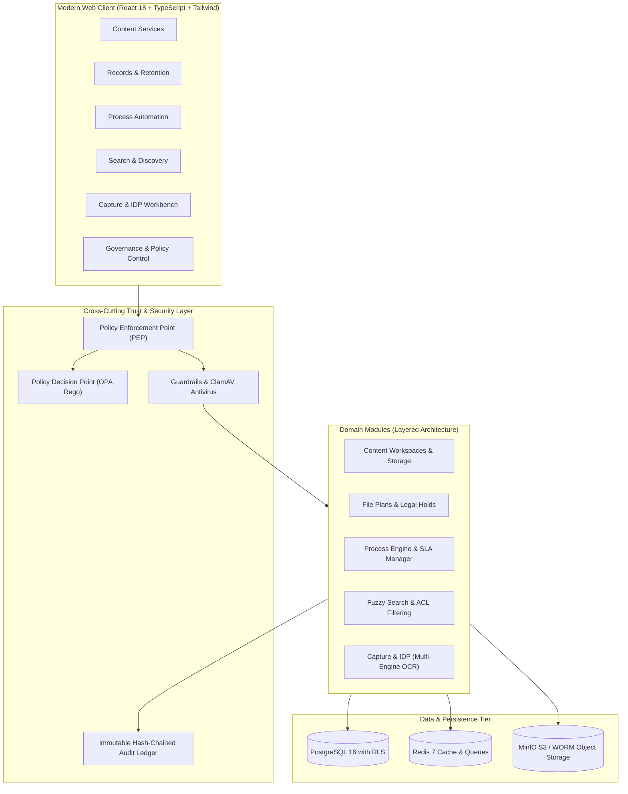

# ⚡ Elixir Enterprise Information Management (Elixir EIM)

[](https://www.python.org/)
[](https://fastapi.tiangolo.com/)
[](https://react.dev/)
[](https://www.typescriptlang.org/)
[](https://www.postgresql.org/)
[](https://www.openpolicyagent.org/)
[](https://www.clamav.net/)
[](LICENSE)

**Elixir EIM** is a production-grade, multi-tenant **Enterprise Information Management (EIM)** and **Intelligent Document Processing (IDP)** suite built as a high-assurance modular monolith. Engineered as an open-source, air-gapped alternative to legacy platforms like OpenText Content Suite and OpenText Vendor Invoice Management (VIM), Elixir EIM unifies enterprise content services, defensible records management, state-machine process automation, permission-filtered search, and proven document capture.

---

## 🏛️ Core Architecture & Principles



### Key Architectural Tenets
1. **Deny By Default (PEP / PDP)**: Every inbound API request is intercepted by the Policy Enforcement Point (`PEP`). Authorization is evaluated centrally against Rego policies running in Open Policy Agent (`OPA`). Zero backdoor endpoints.
2. **Multi-Tenancy with Row-Level Security (RLS)**: Enforced directly at the PostgreSQL 16 engine layer. Every table is bound to `tenant_id` via PostgreSQL session variables (`app.current_tenant_id`) ensuring zero data bleed between tenants.
3. **Immutable Audit Ledger**: Every action generates a cryptographically linked SHA-256 linear hash-chained audit event for SOC 2 Type II and ISO 27001 non-repudiation.
4. **Air-Gapped & Offline-First**: Operates strictly within your perimeter with zero telemetry and zero external OCR or LLM API calls.
5. **No Document Text in Logs**: Privacy-first logging; document text and confidential PII are strictly barred from logging frameworks.

---

## 📦 Functional Modules

### 1. 📑 Capture & Intelligent Document Processing (IDP)
*An OpenText VIM-style document capture and mathematical reconciliation engine.*
- **Adaptive Multi-Engine OCR**: Orchestrates **Tesseract 5.4** (with multi-language packs), **Indra OCR** (fast on clean print; supports Latin, Cyrillic, Greek, Devanagari, Bengali and Chinese; does not support Tamil, Telugu, Kannada, or Malayalam), and **PyMuPDF**.
- **Indian GST Invoice Extraction**: Automated extraction of Supplier/Buyer GSTINs, Taxable Value, CGST, SGST, IGST, HSN line items, and bank details.
- **Mod-36 Checksum Repair**: Position-aware OCR error correction that repairs confused characters (`O` vs `0`, `I` vs `1`, `S` vs `5`, `B` vs `8`, `Z` vs `2`) to match official GSTIN checksum algorithms.
- **Rule 46 e-Invoice QR Validation**: Offline decoding and cross-validation of signed e-invoice JWT QR codes using `zxingcpp`.
- **Mathematical Tax Reconciliation**: Enforces strict tax arithmetic:
  $$\text{Taxable Value} + \text{CGST} + \text{SGST} = \text{Total Amount} \quad (\text{Intra-State})$$
  $$\text{Taxable Value} + \text{IGST} = \text{Total Amount} \quad (\text{Inter-State})$$
- **Human-in-the-Loop Workbench**: Side-by-side visual document preview with bounding-box highlights, field correction drawers, and audit trails.

### 2. 📁 Content Services
- Multi-tier folder and workspace management.
- Major/minor document versioning with automated diffs.
- Custom metadata schemas with dynamic validation.
- PDF/A compliance generation and rendition conversions.

### 3. ⚖️ Records & Retention Management
- Defensible multi-phase file plans (Retention, Archival, Permanent Hold, Disposition).
- Automatic time-based and event-based retention triggers.
- Granular legal holds preventing spoliation.
- Dual-authorization disposition approval workflows.

### 4. ⚡ Process Automation & Workflows
- Visual state-machine workflow builder.
- Role-based task inboxes with SLA tracking, escalation paths, and re-assignment.
- Dynamic form rendering for operational data capture.

### 5. 🔍 Permission-Filtered Search & Discovery
- Full-text search powered by PostgreSQL `pg_trgm` and tsvector indexing.
- Department-level zero-leak SQL ACL filtering (e.g., HR users cannot view Finance files).
- Multi-facet drilldown by document type, tags, date range, and metadata fields.

---

## 🛠️ Technology Stack

| Layer | Technologies |
| :--- | :--- |
| **Frontend** | React 18, TypeScript, Tailwind CSS, Radix UI, TanStack Query, Lucide Icons, Vite |
| **Backend API** | FastAPI, Python 3.13, Pydantic v2, SQLAlchemy 2 (asyncpg) |
| **Security & Auth** | Open Policy Agent (OPA), OIDC / Keycloak, ClamAV Antivirus, JWT |
| **Database & Cache** | PostgreSQL 16 (Row-Level Security, pg_trgm), Redis 7 |
| **Storage & Renditions** | MinIO S3 (WORM compliant), Gotenberg (PDF/A engine) |
| **OCR & Vision** | Tesseract 5.4, Indra OCR 1.1, PyMuPDF, OpenCV, zxing-cpp |

---

## 🚀 Quick Start Guide

### Prerequisites
- [Docker Desktop](https://www.docker.com/) (running with WSL2 backend on Windows)
- Python 3.13+
- Node.js 20+

### 1. Clone & Set Up the Environment
```bash
git clone https://github.com/harrish8248/Elixir-EIM.git
cd Elixir-EIM

# Set up Python virtual environment
python -m venv .venv
.\.venv\Scripts\Activate.ps1
pip install -r apps/api/requirements.txt

# Set up Web Frontend dependencies
cd apps/web
npm install
cd ../..
```

### 2. Start Infrastructure Services
```bash
docker compose up -d postgres redis minio opa clamav
```

### 3. Run Database Migrations
```bash
alembic -c migrations/alembic.ini upgrade head
```

### 4. Launch the Application Stack
You can launch both the API and Web client with a single automated script:
```powershell
.\start.ps1 -Demo
```
- **Web Frontend**: [http://localhost:5173](http://localhost:5173)
- **FastAPI Documentation**: [http://127.0.0.1:8000/docs](http://127.0.0.1:8000/docs)
- **Capture & IDP Workbench**: [http://localhost:5173/idp](http://localhost:5173/idp)

---

## 👥 Pre-Seeded Demo Personas

| Persona | Role | Department | Default Credentials | Primary Access |
| :--- | :--- | :--- | :--- | :--- |
| **Sarah Chen** | Platform Administrator | IT / Operations | `admin@elixir.local` / `DemoAdmin2026!` | Full System Administration, Policy Designer |
| **Raj Patel** | Senior Financial Controller | Finance | `finance@elixir.local` / `DemoFinance2026!` | Invoices, Capture Workbench, PO Matching |
| **Maria Santos** | HR Director | Human Resources | `hr@elixir.local` / `DemoHR2026!` | Personnel Records, Employee File Plans |
| **David Kim** | Compliance Auditor | Legal & Risk | `auditor@elixir.local` / `DemoAuditor2026!` | Immutable Audit Ledger, Legal Holds |

---

## 🧪 Testing & Verification

Elixir EIM includes comprehensive test suites across security, OCR accuracy, and architecture:

```powershell
# 1. Benchmark Integrity & Frozen Manifest Verification
pytest apps/api/tests/test_benchmark_integrity.py -v

# 2. Strict Layered Architecture Contract Check
import-linter --config importlinter.ini

# 3. Route Coverage & PEP/PDP Authorization Enforcement
pytest apps/api/tests/test_route_coverage.py -v

# 4. Search ACL Filtering & Department Isolation
pytest apps/api/tests/test_search_acl_and_fuzzy.py -v
```

---

## 📂 Repository Layout

```
Elixir-EIM/
├── apps/
│   ├── api/                     # FastAPI Backend Application
│   │   ├── app/
│   │   │   ├── admin/           # Tenant, User, and System Administration
│   │   │   ├── audit/           # Cryptographic Hash-Chained Audit Ledger
│   │   │   ├── content/         # Workspaces, Documents & IDP Engine
│   │   │   │   └── idp/         # Multi-Engine OCR, GST Extractor, VIM Validation
│   │   │   ├── guardrails/      # ClamAV scan, File Magic Bytes, Ingestion safety
│   │   │   ├── identity/        # Auth, Sessions & SCIM Provisioning
│   │   │   ├── pep/             # Policy Enforcement Point
│   │   │   ├── records/         # File Plans, Retention, and Legal Holds
│   │   │   ├── search/          # Permission-Filtered Full-Text Search
│   │   │   ├── tenancy/         # RLS Session Context & Multi-Tenancy
│   │   │   └── workflow/        # Process Automation & State Machines
│   │   └── tests/               # Test suites (RLS, ACL, Integrity, Route coverage)
│   └── web/                     # React 18 Single Page Application
│       ├── src/
│       │   ├── components/      # UI Shell, Navigation, Guardrails Modals
│       │   ├── modules/         # Content, IDP, Records, Automation, Search views
│       │   └── config/          # Auth context, API clients, Query providers
├── docs/                        # Specifications, Benchmarks, Control Inventory
│   ├── ocr-benchmark/           # Frozen Synthetic & Degraded Benchmark Datasets
│   ├── ARCHITECTURE.md          # Architectural blueprints and boundaries
│   ├── CONTROL_INVENTORY.md     # SOC 2 & Security control mappings
│   └── PROGRESS.md              # Milestone tracking & release logs
├── migrations/                  # Alembic database migration revisions
├── policies/                    # OPA Rego policy definitions
├── scripts/                     # Seeding, Benchmark generation & utilities
└── docker-compose.yml           # Local infrastructure stack definition
```

---

## 📄 License & Compliance

Distributed under the Apache 2.0 License. Designed to satisfy compliance criteria for **SOC 2 Type II**, **ISO 27001**, **HIPAA**, and **GDPR** records disposition requirements.

